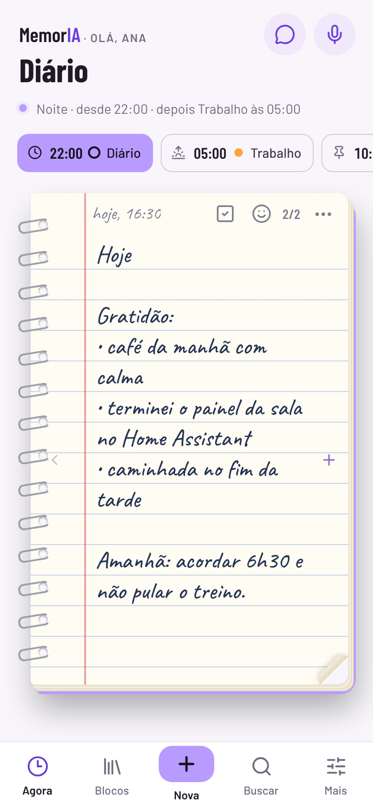
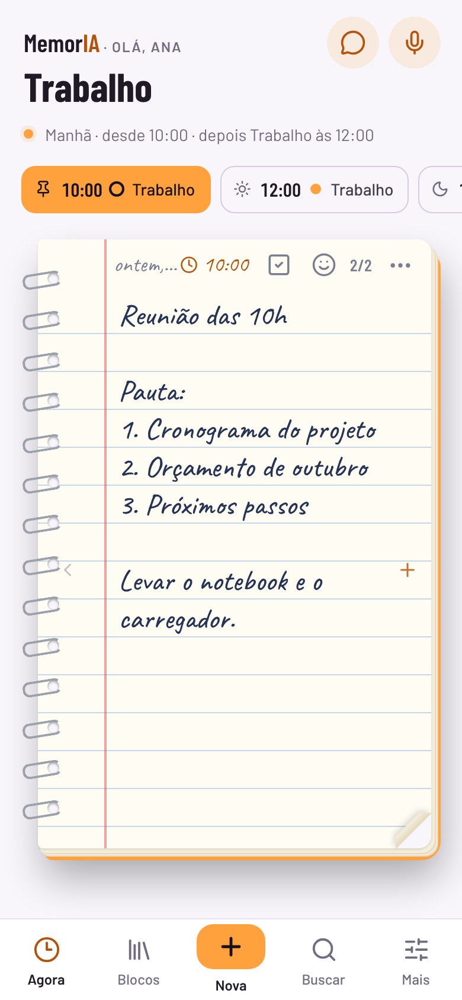
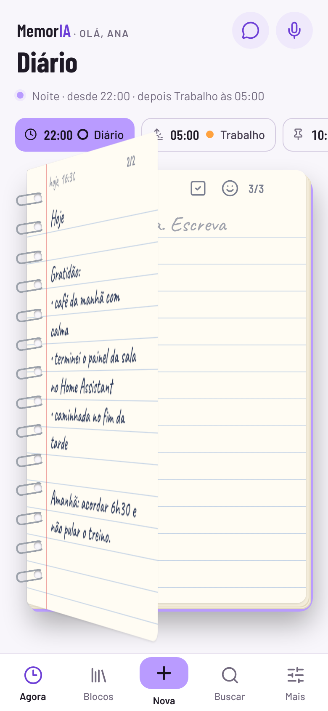
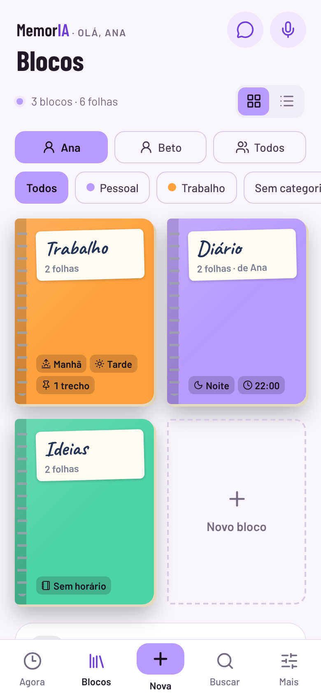

# MemorIA para Home Assistant


Um App do Home Assistant com **blocos de anotações em forma de caderno**. Cada bloco pode **abrir sozinho** conforme o período do dia (de manhã um, à tarde outro, à noite outro) ou em **horários exatos** (07h esse, 10h esse trecho, 22h esse). Para escrever outra folha, é só **tocar na borda e virar a página**.

<p align="center">
  
  
  
  
</p>

[](https://my.home-assistant.io/redirect/supervisor_add_addon_repository/?repository_url=https%3A%2F%2Fgithub.com%2Fdiegozapella63%2Fmemoria-ha)

## Instalação

1. Toque no botão acima. Se preferir, no Home Assistant abra **Configurações → Aplicativos → Loja de aplicativos**, toque no menu **⋮ → Repositórios** e cole:
   ```
   https://github.com/diegozapella63/memoria-ha
   ```
2. Procure **MemorIA** na loja, toque em **Instalar** e depois em **Iniciar**.
3. Ative **Mostrar na barra lateral**.

A primeira instalação leva alguns minutos, porque o app é montado no próprio Home Assistant.

## O que tem

- **Caderno de verdade**: espiral, folhas pautadas, quadriculadas, pontilhadas ou lisas, letra de mão e cor de capa por bloco.
- **Virar a página com um toque**: borda direita vai para a próxima folha (ou uma nova, pronta para escrever); borda esquerda volta. Arrastar também vira.
- **Abre sozinho**: cada bloco pode ter períodos (manhã, tarde, noite, com horários de início ajustáveis) e horários exatos.
- **Trechos com horário**: uma folha específica pode aparecer às 10h, por exemplo a pauta de uma reunião.
- **Tela Agora** com a linha do tempo do dia: toque num horário para espiar o que vem depois.
- **Estante de blocos** com o **Seu dia**: os horários de hoje, com o de agora marcado.
- **Categorias** para agrupar os blocos (Trabalho, Casa, Estudos…), com filtro na estante.
- **De quem é**: um bloco de uma pessoa da casa só abre sozinho no Agora dela; os de Todos, para todo mundo.
- **Arquivar bloco**: sai da estante, do Agora e da busca sem apagar nada e fica em **Arquivados**, no fim de Blocos.
- **Relatório** dos blocos e das folhas, com **Baixar PDF** (funciona no app do Home Assistant no celular).
- **No ⋯ da folha**: horário próprio, mover para outro bloco, adicionar link, copiar o texto ou arrancar a folha, com Desfazer.
- **Caixas de marcar e emojis**: no alto da folha, transforme linhas em itens com caixa para marcar como feito com um toque, e ponha emojis sem fechar o teclado.
- **Links que abrem com um toque**: endereços na folha viram etiquetas curtas (o nome, ou o site), sem aquele texto comprido.
- **Nova folha de mensagem ou foto**: cole uma mensagem do WhatsApp, escolha fotos ou digitalize uma anotação em papel; a IA configurada no Home Assistant (Claude, OpenAI, Gemini ou Ollama) transcreve e você revisa. Escolha qual em **Mais → Configurações → Integrações**.
- **Falar e Conversar com a IA**, no alto das telas: diga uma anotação (a fala para texto do Home Assistant transcreve e a IA organiza) ou converse sobre os blocos; o que a IA propõe escrever só acontece depois do seu toque.
- **Buscar** em todas as folhas, sem se importar com acentos.
- **Sensor** `sensor.memoria_agora` com o bloco e a folha do momento, para painéis e automações.
- **CorrerIA**: com o app CorrerIA, o WhatsApp, o Claude e o Gemini leem e mudam os blocos (buscar, ler, criar e editar folhas, links, blocos e categorias). Ligue em **Mais → Configurações → Integrações**.
- **Salvo no Home Assistant**: sincroniza na hora entre aparelhos e entra no backup.
- **Dados**: exportar (ZIP com um arquivo de texto por bloco, CSV e JSON), backup na pasta `share/memoria`, importar, versões anteriores automáticas e começar do zero.
- **Mais** em menu, como nos outros apps: **Categorias**, **Relatório**, **Configurações** em abas (Integrações, Dados, Aparência e Opções) e **Sobre**. Arrastar o dedo para os lados troca de aba.
- **Aparência**: tema automático (segue o claro ou escuro do Home Assistant, na hora), claro ou escuro, **Cor do dia** ou uma das 10 cores, e letra de mão, que dá para desligar.

Mais detalhes em [memoria/DOCS.md](memoria/DOCS.md).

## Estrutura

```
repository.yaml          repositório de apps
memoria/                 o app (config, Dockerfile, servidor Node.js)
frontend/                código-fonte da interface (Lit)
preview/                 prévia da interface com blocos de exemplo
docs/                    telas de exemplo do README
dev/fake-ha.mjs          Home Assistant falso para desenvolver sem o HA
```

## Desenvolvimento

```bash
cd frontend && npm install && npm run build      # gera memoria/rootfs/app/www/memoria.js
node dev/fake-ha.mjs                             # HA falso em :8123 (token "dev")
MEMORIA_DEV=1 HA_WS_URL=ws://127.0.0.1:8123/api/websocket HA_REST_URL=http://127.0.0.1:8123/api \
  HA_TOKEN=dev DATA_DIR=./.data MEDIA_DIR=./.data/media SHARE_DIR=./.data/share node memoria/rootfs/app/server.js
                                                 # abre em http://127.0.0.1:8099
```

Testes: `npm test` (servidor, com `node:test`) e as conferências visuais na prévia (Playwright), descritas em [tests/README.md](tests/README.md). O GitHub roda todos a cada push.

Arquivos iguais aos dos outros apps da família (ao mudar um, mude nos outros): `frontend/src/selectsheet.js`, `about.js`, `look.js`, `swipe.js`, `voice.js` e `chat.js` (os do ResolvIA e da CronologIA) e `memoria/rootfs/app/lib/ws.js`, `ha.js` e `voice.js` (os de `lib/` do ResolvIA). O `lib/pdf.js` é o do ResolvIA, com o nome do app como opção.

O HA falso simula duas IAs (`ai_task.google_ai_task`, que lê fotos, e `ai_task.ollama_ai_task`, só texto) e recebe o `sensor.memoria_agora`; use `FAKE_MEDIA_DIR` igual a `MEDIA_DIR` para testar a leitura de fotos, ou `FAKE_HA_NO_AI=1` para testar sem IA. A prévia (`preview/memoria-preview.html`) abre direto no navegador, sem servidor.

## Como os apps conversam

- **CorrerIA → MemorIA** (o contrato é o mesmo para todos os apps da família; ver o AGENTS.md do `correria-ha`): com **Mais › Configurações › Integrações › CorrerIA** ligado (desligado por padrão, sem depender do Usar IA), o app grava `share/memoria/correria.json` (`app: "memoria"`, `nome`, `assunto`, `url`, `ip_url`, `chave`, `versao`, `ferramentas`, `gravado_em`; permissão 600, gravado de uma vez; chave própria em `/data/correria.key`; `MEMORIA_URL_INTERNA` troca o `url`) e responde, com `Authorization: Bearer <chave>`, em `GET /api/integracao/ferramentas` → `{instrucoes, ferramentas: [{nome, titulo, descricao, entrada (JSON Schema), grava, apaga}]}` e `POST` `{nome, argumentos, pessoa, cliente}` → `{texto}` (400 `{erro}` dizendo o que vale; 404 ferramenta desconhecida; 401 desligado ou chave errada). As ferramentas (`memoria/rootfs/app/lib/ferramentas.js`): `resumo`, `buscar`, `ler_bloco`, `ler_folha`, `nova_folha`, `acrescentar`, `editar_folha`, `adicionar_link`, `apagar_folha`, `novo_bloco`, `editar_bloco` (também `de` e `arquivado`) e `nova_categoria`; os blocos arquivados ficam fora do `resumo` e do `buscar` sem `arquivados: true`, e as folhas deles não mudam; o `agora` do `resumo` é o da `pessoa` (os blocos dela e os de todos); gravam pelas mesmas funções da tela (`lib/store.js` e as regras de `lib/writing.js`, usadas também pela interface) e avisam todas as telas pelo WebSocket. Desligado, o arquivo some. O último uso (`cliente` e quando) fica em `/data/correria-uso.json` e aparece no cartão.

## Créditos

[Lit](https://lit.dev) (BSD-3-Clause), ícones [Lucide](https://lucide.dev) (ISC), fontes [Barlow](https://fonts.google.com/specimen/Barlow), [Barlow Condensed](https://fonts.google.com/specimen/Barlow+Condensed) e [Caveat](https://fonts.google.com/specimen/Caveat) (SIL Open Font License).
