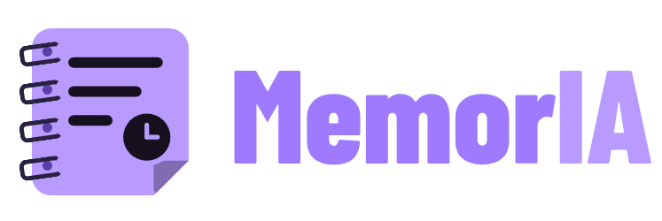
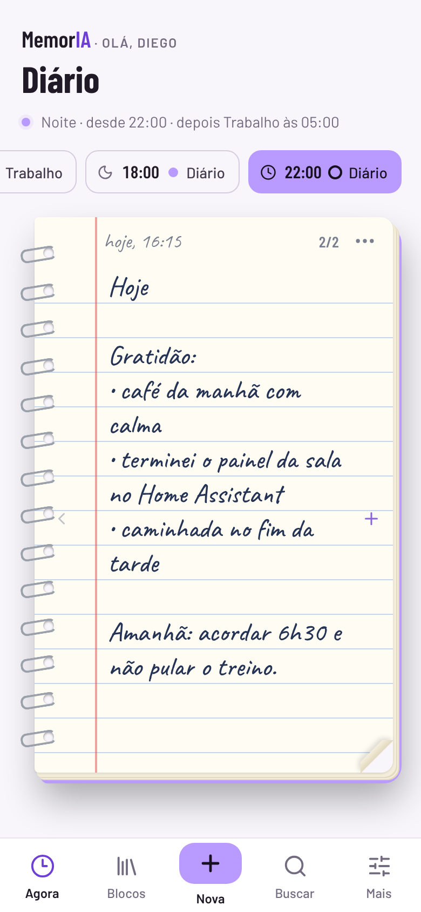
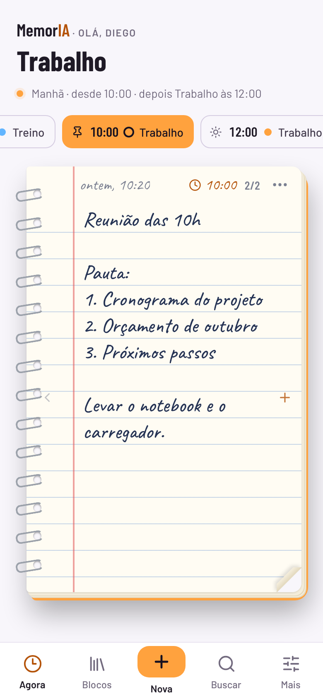
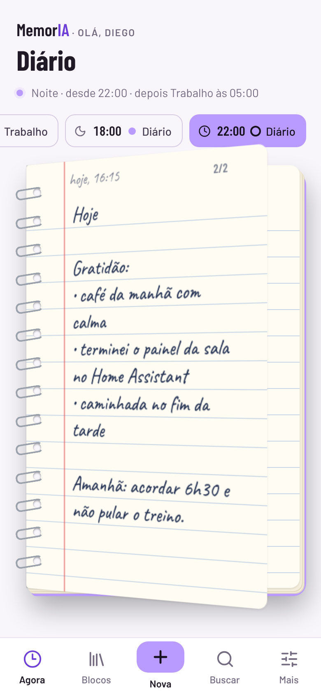
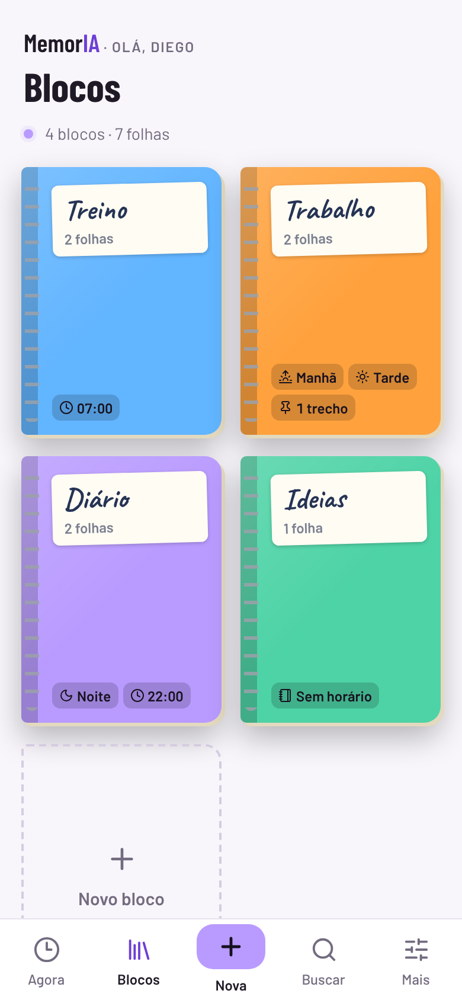

# MemorIA para Home Assistant



Um App do Home Assistant com **blocos de anotações em forma de caderno**. Cada bloco pode **abrir sozinho** conforme o período do dia (de manhã um, à tarde outro, à noite outro) ou em **horários exatos** (07h esse, 10h esse trecho, 22h esse). Para escrever outra folha, é só **tocar na borda e virar a página**.

<p align="center">
  
  
  
  
</p>

[](https://my.home-assistant.io/redirect/supervisor_add_addon_repository/?repository_url=https%3A%2F%2Fgithub.com%2Fdiegozapella63%2Fmemoria-ha)

## Instalação

1. Toque no botão acima. Se preferir, no Home Assistant abra **Configurações → Aplicativos → Loja de aplicativos**, toque no menu **⋮ → Repositórios** e cole:
   ```
   https://github.com/diegozapella63/memoria-ha
   ```
2. Procure **MemorIA** na loja, toque em **Instalar** e depois em **Iniciar**.
3. Ative **Mostrar na barra lateral**.

A primeira instalação leva alguns minutos, porque o app é montado no próprio Home Assistant.

## O que tem

- **Caderno de verdade**: espiral, folhas pautadas, quadriculadas, pontilhadas ou lisas, letra de mão e cor de capa por bloco.
- **Virar a página com um toque**: borda direita vai para a próxima folha (ou uma nova, pronta para escrever); borda esquerda volta. Arrastar também vira.
- **Abre sozinho**: cada bloco pode ter períodos (manhã, tarde, noite, com horários de início ajustáveis) e horários exatos.
- **Trechos com horário**: uma folha específica pode aparecer às 10h, por exemplo a pauta de uma reunião.
- **Tela Agora** com a linha do tempo do dia: toque num horário para espiar o que vem depois.
- **Nova folha de mensagem ou foto**: cole uma mensagem do WhatsApp, escolha fotos ou digitalize uma anotação em papel; a IA configurada no Home Assistant (Claude, OpenAI, Gemini ou Ollama) transcreve e você revisa. Escolha qual em **Mais → Leitura por IA**.
- **Buscar** em todas as folhas, sem se importar com acentos.
- **Sensor** `sensor.memoria_agora` com o bloco e a folha do momento, para painéis e automações.
- **Salvo no Home Assistant**: sincroniza na hora entre aparelhos e entra no backup.
- **Tema claro e escuro** seguindo o Home Assistant.

Mais detalhes em [memoria/DOCS.md](memoria/DOCS.md).

## Estrutura

```
repository.yaml          repositório de apps
memoria/                 o app (config, Dockerfile, servidor Node.js)
frontend/                código-fonte da interface (Lit)
preview/                 prévia da interface com blocos de exemplo
docs/                    telas de exemplo do README
dev/fake-ha.mjs          Home Assistant falso para desenvolver sem o HA
```

## Desenvolvimento

```bash
cd frontend && npm install && npm run build      # gera memoria/rootfs/app/www/memoria.js
node dev/fake-ha.mjs                             # HA falso em :8123 (token "dev")
MEMORIA_DEV=1 HA_WS_URL=ws://127.0.0.1:8123/api/websocket HA_REST_URL=http://127.0.0.1:8123/api \
  HA_TOKEN=dev DATA_DIR=./.data MEDIA_DIR=./.data/media node memoria/rootfs/app/server.js
                                                 # abre em http://127.0.0.1:8099
```

O HA falso simula duas IAs (`ai_task.google_ai_task`, que lê fotos, e `ai_task.ollama_ai_task`, só texto) e recebe o `sensor.memoria_agora`; use `FAKE_MEDIA_DIR` igual a `MEDIA_DIR` para testar a leitura de fotos, ou `FAKE_HA_NO_AI=1` para testar sem IA. A prévia (`preview/memoria-preview.html`) abre direto no navegador, sem servidor.

## Créditos

[Lit](https://lit.dev) (BSD-3-Clause), ícones [Lucide](https://lucide.dev) (ISC), fontes [Barlow](https://fonts.google.com/specimen/Barlow), [Barlow Condensed](https://fonts.google.com/specimen/Barlow+Condensed) e [Caveat](https://fonts.google.com/specimen/Caveat) (SIL Open Font License).
